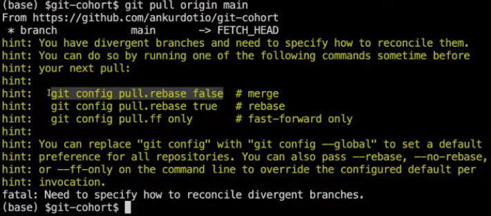
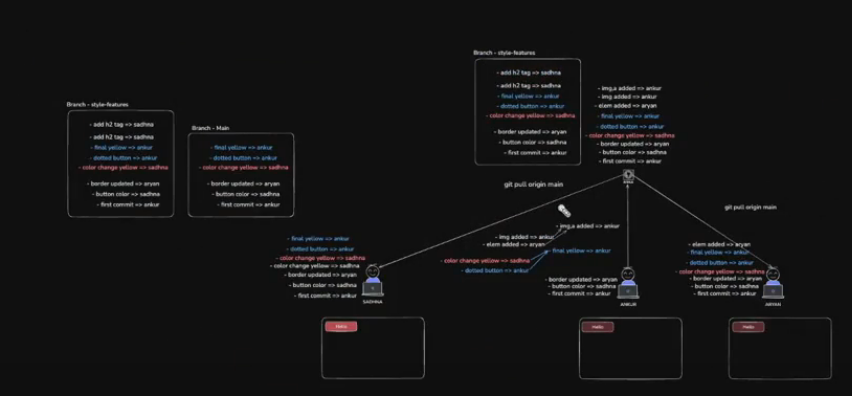

when do conflict arise 

- whenever a collabrator pushes some code and insteading of pulling the latest code u try to push some of your own it gives a condlict
- when changes made on github dont align with ur local system changes and u try to pull 
- incoming change other collabrators code current change ur code 
- merge resolve krne ke baad jb commit kroge toh finsl commit or jo commit conflict raise kr rha tha dono jayenga 

- git branch for number of branchs git branch <branch_name> for accessing branch

- create another branch git branch
- form one branch to another branch git checkout <branch_name>
- git pull origin <branch_name> pull from one branch to another

